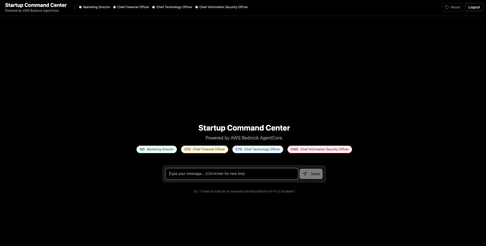
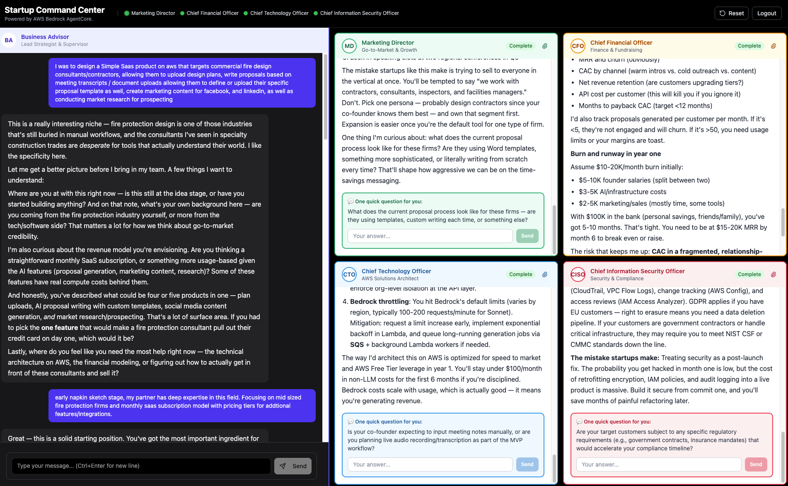

# Startup Command Center
### Powered by AWS Bedrock AgentCore

The **Startup Command Center** is a full-stack multi-agent AI demo built on [AWS Bedrock AgentCore](https://aws.amazon.com/bedrock/agentcore/) using the [Claude Agent SDK](https://docs.anthropic.com/en/docs/claude-code/sdk). Submit any startup idea and instantly receive parallel analysis from a coordinated team of four AI specialists — all running simultaneously on AWS, streamed live to a React dashboard.

---

## Screenshots

### Welcome Screen


### Dashboard — Live Multi-Agent Analysis


---

## What It Does

You describe a startup idea in plain text. The **Business Advisor** (supervisor agent) receives your message, scopes it, then simultaneously delegates to four specialist subagents. Each specialist streams its response directly into its own panel as it arrives — no waiting for one to finish before the next starts.

| Agent | Role | Focus |
|---|---|---|
| **Business Advisor** | Supervisor | Synthesizes cross-functional strategy, asks clarifying questions |
| **Marketing Director (MD)** | Specialist | Go-to-market, customer acquisition, branding, competitive positioning |
| **Chief Financial Officer (CFO)** | Specialist | Unit economics, financial modeling, pricing, fundraising strategy |
| **Chief Technology Officer (CTO)** | Specialist | AWS architecture, serverless stack, MVP scoping, cloud infrastructure |
| **Chief Information Security Officer (CISO)** | Specialist | AWS security best practices, IAM, compliance, threat modeling |

Each specialist can ask the user **one targeted follow-up question**, rendered inline in its panel. Answering re-invokes only that specialist — the other panels are untouched.

---

## AWS Architecture

```
User Browser
     │
     ▼
┌─────────────────────────────────────────────────────┐
│  Layer 1 — Frontend Hosting                         │
│  AWS Amplify  (React / TypeScript / Vite)           │
│  • Static site served via CloudFront (HTTPS)        │
│  • Dark shell + light specialist panels             │
│  • aws-exports.json injected at deploy time         │
└─────────────────────────┬───────────────────────────┘
                          │  Login redirect
                          ▼
┌─────────────────────────────────────────────────────┐
│  Layer 2 — Authentication                           │
│  Amazon Cognito User Pool                           │
│  • OAuth2 Authorization Code flow                   │
│  • Short-lived JWT issued to browser                │
│  • Same JWT authorizes AgentCore + API Gateway      │
└──────┬──────────────────┬──────────────────────────┘
       │ JWT (Auth header) │ JWT (Auth header)
       ▼                   ▼
┌──────────────┐   ┌───────────────────────────────────────┐
│  Layer 4     │   │  Layer 3 — Agent Runtime (Core)        │
│  API Gateway │   │  AWS Bedrock AgentCore Runtime         │
│  REST API    │   │                                        │
│  /feedback   │   │  Supervisor Agent (Claude Opus 4.6)    │
│  /documents  │   │  ┌──────────────────────────────────┐  │
│    /presign  │   │  │  Parallel Subagents               │  │
│    /extract  │   │  │  • Marketing Director  (MD)       │  │
└──────┬───────┘   │  │  • Chief Financial Officer (CFO)  │  │
       │           │  │  • Chief Technology Officer (CTO)  │  │
       ▼           │  │  • CISO          (Claude Sonnet)  │  │
┌──────────────┐   │  └──────────────────────────────────┘  │
│  AWS Lambda  │   └───────────────┬───────────────────────┘
│  (Python     │           M2M OAuth2 (Client Credentials)
│   3.13 ARM)  │                   │
│  • Presigned │                   ▼
│    S3 URLs   │   ┌───────────────────────────────────────┐
│  • Textract  │   │  AWS Bedrock AgentCore Services        │
│    extract   │   │  • Memory  — cross-session context     │
└──────┬───────┘   │  • Identity — M2M Token Vault          │
       │           └───────────────────────────────────────┘
       ▼
┌──────────────────────────────────────────────────────┐
│  Layer 5 — Storage                                   │
│  Amazon S3 (Documents Bucket)                        │
│  • Browser PUTs directly via presigned URL           │
│  • Scoped per agent + session                        │
└──────────────────────┬───────────────────────────────┘
                       │
                       ▼
┌──────────────────────────────────────────────────────┐
│  Amazon Textract                                     │
│  • Extracts text from PDFs / PNGs                    │
│  • Output passed to specialist agent as context      │
└──────────────────────────────────────────────────────┘

Layer 6 — Infrastructure & Ops
  AWS CDK (TypeScript) → CloudFormation nested stacks
  AWS Systems Manager (SSM) — runtime config params
  Amazon CloudWatch — agent + Lambda log groups
```

---

### Layer-by-Layer Breakdown

#### Layer 1 — Frontend Hosting: AWS Amplify
- Hosts the React/TypeScript/Vite app as a static site via CloudFront with a managed HTTPS domain
- The deploy script builds the app, injects a runtime `aws-exports.json` (ARNs, Cognito pool IDs, API URL), packages it, and pushes to an S3 staging bucket — Amplify picks it up and deploys automatically
- No server-side rendering — every request is handled client-side; all auth and data flows go directly to AWS services

#### Layer 2 — Authentication: Amazon Cognito
- Users authenticate via the Cognito Hosted UI using the **OAuth2 Authorization Code** flow
- After login, the browser holds a short-lived **JWT access token**
- The JWT is passed as the `Authorization` header on **every** downstream request — both to AgentCore Runtime and API Gateway
- The same Cognito User Pool acts as authorizer for both services, so there is one identity plane for the whole app
- Users can be added directly through the AWS Console (Cognito → User Pools → Create user) — no code changes required

#### Layer 3 — Agent Runtime: AWS Bedrock AgentCore (Core)
This is where all the AI work happens.

- The frontend calls the **AgentCore Runtime invoke endpoint** with the user's message and JWT
- The Runtime runs the **supervisor agent (Claude Opus 4.6)** inside a managed Docker container
- The supervisor uses the Claude Agent SDK `Agent` tool to fan out to **four parallel specialist subagents (Claude Sonnet 4.6)** simultaneously:

```
Supervisor (Claude Opus 4.6)
├── Marketing Director  (Claude Sonnet 4.6) ─┐
├── Chief Financial Officer (Sonnet 4.6)     ├─ run in parallel
├── Chief Technology Officer (Sonnet 4.6)    │
└── CISO (Sonnet 4.6) ──────────────────────┘
```

- Each subagent runs independently and streams its result back through the supervisor's **SSE (Server-Sent Events)** stream
- The frontend SSE parser identifies `subagent_start` and `subagent_result` events and routes each response to the correct specialist panel in real time — no polling, no waiting for one agent to finish before the next starts

**AgentCore Memory** — the Runtime is wired to a Bedrock AgentCore Memory store, giving agents cross-session recall. Agents can reference prior conversations without the user repeating context.

**AgentCore Identity / Token Vault** — manages M2M OAuth2 credentials (Client Credentials flow) so the Runtime can call downstream AgentCore services (Memory, Gateway) without any secrets in application code.

#### Layer 4 — Secondary API: API Gateway + Lambda
A separate REST API handles non-agent operations, protected by the same Cognito authorizer:

| Route | Handler | Purpose |
|---|---|---|
| `POST /feedback` | Lambda | User feedback submission |
| `POST /documents/presign` | Lambda | Generate a pre-signed S3 PUT URL for direct browser upload |
| `POST /documents/extract` | Lambda | Call Textract on an uploaded file and return extracted text |

**AWS Lambda (Python 3.13, ARM64)** — handles both document routes. Pre-signed URLs let the browser PUT files directly to S3, bypassing API Gateway's payload size limits.

#### Layer 5 — Storage: S3 + Textract
- **Amazon S3** stores user-uploaded documents (PDFs, PNGs, CSVs, TXT) scoped per agent and session under `documents/{agentId}/{sessionId}/`
- The browser uploads directly to S3 via a pre-signed PUT URL — files never pass through Lambda
- **Amazon Textract** extracts text from PDFs and images; the extracted content is passed to the relevant specialist agent as additional context

#### Layer 6 — Infrastructure & Ops
- **AWS CDK (TypeScript)** defines all infrastructure as code across nested stacks (Amplify, Cognito, Backend). A single `cdk deploy` provisions everything
- **AWS CloudFormation** executes the CDK-generated templates and manages stack state
- **AWS Systems Manager (SSM)** stores runtime config values (API URL, bucket name) as parameters, so the deploy script can read stack outputs without hardcoding
- **Amazon CloudWatch** captures log groups for Lambda functions and the AgentCore Runtime container — used to trace SSE events, subagent routing, and errors

---

### End-to-End Request Flow

```
1. User types startup idea → React frontend (Amplify)
2. Frontend sends invoke request to AgentCore Runtime
     └─ Authorization: Bearer <Cognito JWT>
3. Cognito validates JWT → Runtime accepted
4. Supervisor Agent (Claude Opus 4.6) receives message
5. Supervisor fans out via Agent tool × 4 (parallel)
     ├─ Marketing Director analyzes go-to-market
     ├─ CFO analyzes unit economics + fundraising
     ├─ CTO designs AWS architecture + stack
     └─ CISO reviews security posture + compliance
6. Each subagent streams result → supervisor SSE stream
7. SSE events arrive at browser in real time:
     subagent_start  → panel enters "Analyzing..." state
     subagent_result → panel renders specialist response
     text            → Business Advisor panel updates
8. Supervisor synthesizes cross-functional summary
9. Each specialist may append one FOLLOW_UP: question
     └─ User answers inline → only that agent re-invokes
```

---

## AWS Services Used

| Service | Purpose |
|---|---|
| **AWS Bedrock AgentCore Runtime** | Hosts and executes the multi-agent system |
| **AWS Bedrock AgentCore Memory** | Cross-session memory for agents |
| **AWS Bedrock AgentCore Identity** | M2M credential management (Token Vault) |
| **Amazon Bedrock** | Underlying model API (Claude Opus 4.6 + Sonnet 4.6) |
| **AWS Amplify Hosting** | React frontend hosting with CI/CD |
| **Amazon Cognito** | User authentication (OAuth2, JWT) |
| **Amazon API Gateway** | REST API for documents + feedback |
| **AWS Lambda** | Document presign + Textract extract handlers |
| **Amazon S3** | Document storage + Amplify staging bucket |
| **Amazon Textract** | PDF/image text extraction |
| **AWS CDK** | Infrastructure as Code |
| **AWS CloudFormation** | Underlying stack deployment |
| **AWS Systems Manager (SSM)** | Runtime config parameter storage |
| **Amazon CloudWatch** | Agent and Lambda logging |

---

## Key Features

- **Parallel multi-agent streaming** — all 4 specialists run simultaneously, not sequentially
- **Per-panel follow-up questions** — each specialist can request one clarification; the answer re-invokes only that specialist
- **Dark shell / light panels** — black app background with white lettering; specialist panels use light mode with color-coded accents
- **Document upload per panel** — upload PDFs, PNGs, CSVs, or TXT files as additional context for any specialist (stored in S3, extracted via Textract)
- **AWS-only CTO recommendations** — the CTO persona is an AWS Solutions Architect and names specific services (Lambda, DynamoDB, Cognito, etc.)
- **CISO specialist** — dedicated security advisor for AWS security best practices, IAM, and compliance, coordinated with the CTO

---

## Quick Deploy

```bash
# Prerequisites: Node.js, Python 3.8+, AWS CLI, Docker

# 1. Clone and configure
git clone <repo>
cd fullstack-solution-template-for-agentcore
# Edit infra-cdk/config.yaml — set stack_name_base and admin_user_email

# 2. Deploy infrastructure
cd infra-cdk
npm install
npx cdk bootstrap   # once per account/region
npx cdk deploy

# 3. Deploy frontend
cd ..
python3 scripts/deploy-frontend.py
```

The deploy script auto-loads `.env` from the project root. Create a `.env` file to pin your account/region:

```
AWS_PROFILE=<your-profile>
AWS_DEFAULT_REGION=us-east-1
```

See [`docs/DEPLOYMENT.md`](docs/DEPLOYMENT.md) for the full deployment guide.

---

## Project Structure

```
fullstack-solution-template-for-agentcore/
├── patterns/
│   └── claude-agent-sdk-multi-agent/
│       ├── agent.py              # Supervisor agent + SSE streaming
│       └── agents/
│           └── subagents.py      # MD, CFO, CTO, CISO definitions
├── frontend/
│   └── src/components/dashboard/
│       ├── DashboardInterface.tsx # Main layout + event routing
│       ├── AgentPanel.tsx         # Per-specialist panel + follow-up UI
│       ├── DashboardHeader.tsx    # App header with agent status dots
│       └── agentConfig.ts         # Agent names, colors, labels
├── infra-cdk/
│   ├── lib/
│   │   ├── backend-stack.ts      # AgentCore Runtime + API Gateway + S3
│   │   ├── cognito-stack.ts      # Cognito User Pool
│   │   ├── amplify-hosting-stack.ts
│   │   └── fast-main-stack.ts    # Root stack + CDK outputs
│   └── lambdas/
│       ├── document-upload/      # Presign + Textract Lambda
│       └── feedback/             # Feedback API Lambda
├── scripts/
│   └── deploy-frontend.py        # Amplify deployment script
├── docs/
│   ├── screenshots/              # App screenshots
│   └── architecture-diagram/     # Architecture diagrams
└── infra-cdk/config.yaml         # Deployment configuration
```

---

## About FAST

This demo is built on the **Fullstack AgentCore Solution Template (FAST)** — a starter framework for deploying secured, web-accessible React frontends connected to AgentCore backends. FAST handles infrastructure, authentication, and streaming boilerplate so developers can focus on agent design and prompt engineering.

[](https://deepwiki.com/awslabs/fullstack-solution-template-for-agentcore)

---

## Security

This asset is a proof-of-value demo and is not intended as a production-ready solution. You are responsible for applying appropriate security controls for your use case per the [AWS Shared Responsibility Model](https://aws.amazon.com/compliance/shared-responsibility-model/).

## License

Apache-2.0
